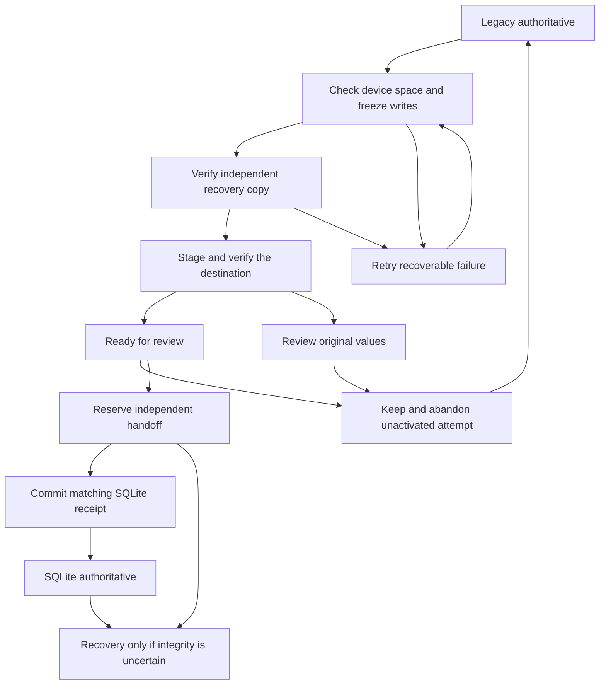
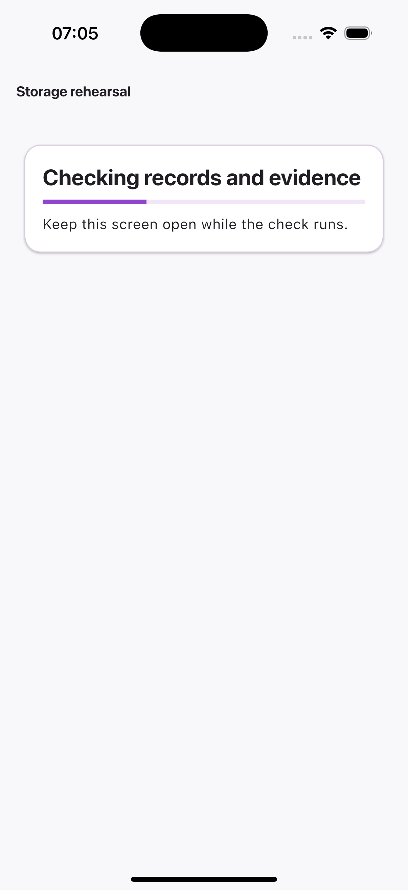
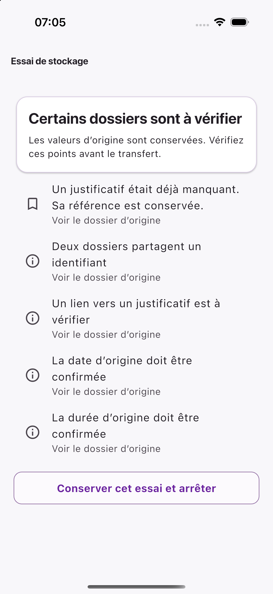
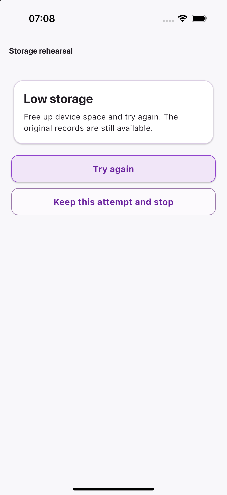

# Phase 3B migration authority and recovery

The normal application entry point and existing recovery paths continue to use SharedPreferences. The production activation guard remains false. Phase 3B adds a read-only startup adapter, a generic authority decision, a two-part handoff, a localized synthetic rehearsal app and nondestructive recovery operations.

## Startup authority

[The generic resolver](../../../lib/recording_engine/storage_authority.dart) selects exactly one writer or a recovery-only state. The [CPD startup adapter](../../../lib/cpd_migration/startup_migration_authority.dart) reads the external handoff marker, SQLite integrity and schema version, matching import verification and CPD source binding. A future startup composition root must run the guarded resolver before constructing any writer. It seals legacy writes whenever startup selects SQLite or recovery.

| Startup evidence | Authority | Behaviour |
| --- | --- | --- |
| New installation, no migration artifacts | SharedPreferences | Continue onboarding. |
| Existing legacy records, no migration artifacts | SharedPreferences | Open existing records. |
| Interrupted inventory, recovery copy or staging, no handoff evidence | SharedPreferences | Resume separately against the same frozen source or keep and abandon the attempt. |
| Verified staging with a healthy destination and no handoff evidence | SharedPreferences | Keep the staged copy for review. |
| Abandoned attempt with no activation evidence | SharedPreferences | Keep its files. Use a new attempt directory for another rehearsal. |
| Matching supported SQLite receipt and independent handoff marker | SQLite | The two bindings match scope, source, recovery fingerprint and a unique handoff ID. The original SQLite verification timestamp and CPD source association also match. |
| Healthy bound SQLite and missing or damaged recovery manifest | SQLite | Flag recovery-copy health separately. Keep current records authoritative. |
| Healthy bound SQLite and damaged progress journal | SQLite | The progress journal provides diagnostics. The two authority artifacts still agree. |
| Pending handoff, missing receipt, wrong scope, mismatched binding or unreadable artifact | Recovery only | Seal the legacy writer. Preserve both stores. An explicit retry cannot reconstruct authoritative SQLite from old data. |
| Missing or corrupt SQLite after attempted handoff | Recovery only | Preserve the marker, any remaining SQLite files and originals. |
| Previous app upgrade with a supported, bound schema | SQLite | Open that database through its approved schema path. A newer or unknown schema stops startup for recovery. |
| Missing destination after Ready, unexplained existing database, or damaged journal with no trusted authority | Recovery only | Require independent verification before clearing uncertainty. |

The handoff marker has a fixed app-private location outside the attempt directory in a future release. Exclusive creation occurs before committing the SQLite receipt. A partially written marker still blocks either store from starting. If the process stops after the receipt commits, the two matching artifacts are sufficient even if the progress screen never reports completion. If it stops between the two writes, startup holds both writers and preserves the files. Approval is required for any repair that would clear a handoff marker. A restored earlier SQLite database with the same binding, or an OS restore that loses all activation evidence, needs separate write-coverage and backup guarantees before release.

## Lifecycle



The debug-only [rehearsal app](../../../test/cpd_migration/phase3b_rehearsal_app.dart) opens only synthetic data under a temporary directory. It uses CPD styling and the six existing application locales. Its progress labels come from coordinator checkpoints. The screen stays in place while an operation is active and exposes retry or preservation on failure. In the review list, a record's original raw value can be inspected without writing it back. The low-storage fixture allows a retry after an injected first-attempt capacity failure.

## Historical data decisions

| Issue | Phase 3B behaviour | Proposal requiring approval |
| --- | --- | --- |
| Duplicate numeric identifiers | Preserve each record and its position in the raw source. Prevent handoff while identity is ambiguous. | Assign distinct IDs after an audited review of every duplicate and reference. Keep every original identifier as provenance. |
| Invalid or ambiguous dates | Preserve the source representation and hold handoff. | Require explicit confirmation of the intended local date and retain both the original and any authorised replacement. |
| Fractional or otherwise unsupported duration | Preserve the exact source and hold handoff. | Add a faithful representation where supportable. Otherwise confirm the intended value and unit before any conversion. |
| Unsupported or unreadable evidence reference | Preserve the original reference and hold handoff. | Allow an explicit relink or reviewed unavailable status, preserving both the source value and the evidence of the decision. |
| Known missing file on an otherwise valid record | Verify the record with an explicit missing-evidence flag. Preserve its locator and pin the recovery copy. | Approve showing the unresolved flag after launch and allow optional relinking. A missing file alone can remain a warning. |
| Malformed row, conflicting target or ambiguous profession | Retain raw source and stop. | Require approved recovery cases with auditable changes. |
| Known record with unknown extension | Preserve the original extension in recovery and flag it. | Decide when opaque data needs additional review or a supported field model. |

## Recovery and rollback

| Situation | Implemented safe operation | Cutover decision |
| --- | --- | --- |
| Unactivated failed, paused or verified attempt | Abandon the attempt without erasing its database or recovery copy. Legacy remains authoritative. Retryable attempts can reuse their verified copy if the source is unchanged. | Approve any later staged-file disposal separately. |
| Recovery snapshot with intact manifest and evidence | Materialise a verified legacy snapshot into a new directory outside either live store. Raw values stay readable independently if individual evidence copies are damaged. | Keep isolated recovery data separate from any future authority decision. |
| Termination during the handoff | Preserve both stores and enter recovery only when a completed matching receipt is unavailable. No restaging over a reserved handoff. | Require reviewed proof before finishing or clearing a pending handoff. |
| Activated database with new or edited records | Cold preservation can copy the database, its sidecars, available authority marker and owned evidence into a separate review directory. Existing files stay in place. On the native test copy, updated records, deletion status and new evidence remained readable. | Require a restore candidate with independently demonstrated coverage of acknowledged writes, or forward repair. There is no live replace or automatic rollback operation. |
| Backup damaged or missing | Healthy bound SQLite remains authoritative. Recovery retention remains on hold. | Restore backup coverage without replacing current data. |

The 30-day minimum still begins at verified activation. Copying recovery material, abandoning a stage and a passing retention date leave the original material in place. Cold preservation requires closing all writers and running under the exclusive startup/recovery host. Roots, database and sidecars stay in place during the copy. This is a forensic preservation operation. Device loss and proving that an older, valid SQLite copy contains acknowledged writes require a separate backup policy.

## Performance and verification on 21 November 2026

Migration inserts use batches of 128 records or evidence rows inside one SQLite transaction. Fresh records avoid per-field delete statements. Verification keeps matching planner metadata in place and avoids an extra read of every recovery file just to get the exclusion list. The independent recovery copy, transaction rollback, source verification and original-byte checks remain in the path.

| Device and rows | Phase 3A | Phase 3B | Peak extra disk | Peak process RSS | First projected search |
| --- | ---: | ---: | ---: | ---: | ---: |
| iOS 18.5 · 32 | 0.77 s | 0.65 s | 3.72 MiB | 559.9 MiB | 4.4 ms |
| iOS 18.5 · 420 | 4.89 s | 4.03 s | 29.46 MiB | 616.5 MiB | 29.1 ms |
| iOS 18.5 · 3,600 | 18.22 s | 13.90 s | 94.59 MiB | 665.7 MiB | 218.7 ms |
| Android 14 · 32 | 1.83 s | 1.67 s | 3.73 MiB | 442.2 MiB | 9.6 ms |
| Android 14 · 420 | 8.10 s | 6.36 s | 29.47 MiB | 424.5 MiB | 39.4 ms |
| Android 14 · 3,600 | 39.35 s | 23.47 s | 94.61 MiB | 433.7 MiB | 153.4 ms |

These are single debug simulator or emulator runs on the same arm64 host, Flutter 3.41.6 and Dart 3.11.4. Disk and RSS are sampled. The large fixture has six professions, 144 owned originals and about 86 MiB of input. Its database remains about 8 MiB. Large-fixture staging time fell from about 6.0 to 2.9 seconds on iOS and from 21.9 to 6.0 seconds on Android. Peak additional storage stayed near 95 MiB. Process RSS includes the debug runner and is not an allocation guarantee. Recheck startup, memory and timing on the device matrix before defining release budgets.

- The full Flutter suite passed 129 tests. The new tests cover contradictory authority inputs, marker scope and format, missing and damaged artifacts, legacy write gating, preserving sidecars and original evidence, blocked back navigation, and French large-text layout. Full-project analysis retained the same 16 pre-existing findings.
- Native SQLite isolation passed on iOS 18.5 and Android 14. The native tests exercised verified staging, abandonment and independent restore, interrupted receipt publication, competing attempts on one handoff marker, bound restart, post-activation creation, edit, deletion and evidence preservation, damaged backups and journals, unsupported schema, and missing or corrupt SQLite.
- An actual Android force-stop between the independent marker and receipt returned to recovery mode after relaunch and refused to rebuild from legacy. The five Android parity scenarios passed again, including real SQLite full rollback, additive schema upgrade, and PDF, CSV and ZIP parity. The scale runs exercised four-language evidence PDF output on both platforms.
- The installed runtimes and connected inventory did not provide iOS 15.6 or Android API 24. The closest tested runtimes were iOS 18.5 and Android API 34. Signed App Store and Play upgrades remain unverified.

## Physical-device verification procedure

1. Use dedicated devices containing synthetic data only. Include iOS 15.6 and Android API 24, an older low-memory device and a current reference device. Record exact OS, app and build versions, architecture, free space and toolchain.
2. Install the currently published signed build through its existing distribution channel using the approved QA identity. Seed the same 32, 420 and 3,600-record profiles with six professions, targets, archived and deleted data, and mixed originals. Keep a read-only inventory and byte digests. Record the installer channels and application identifiers and preserve them for a genuine upgrade. Use a separate disposable signing identity for the internal rehearsal UI. Never replace a personal app installation.
3. Upgrade the QA installation in place to a signed candidate with the production guard false. Confirm normal preferences startup, field values, duration totals, search, attachments, PDF/CSV/ZIP and deleted-record recovery. Time first frame and the first usable record view.
4. In the isolated rehearsal run each size at normal and constrained disk capacity. Capture time per checkpoint, peak process RSS and temporary storage, database size, first search, and export time. Check capacity interruption before evidence copy and before SQLite creation. Verify the independent copy after force termination before staging, during verification, after reserving handoff and just after the SQLite commit.
5. Exercise the bound rehearsal writer. Create and edit records, soft-delete and restore, update a target, add and open evidence, and export after restart. Compare against an independently saved inventory of acknowledged changes. Simulate a missing receipt, a corrupt database and a broken recovery copy. Confirm no legacy writer opens in unresolved handoff states.
6. With writers closed, preserve SQLite and evidence to an isolated directory. Prove that the copy retains post-activation records and attachment bytes. Exercise the approved recovery and upgrade path again before authorising a release. Actual production handoff tests require a separately approved cutover build and release gate.

## Running the disposable app

Start from the disposable native app in the [Phase 3A rehearsal instructions](phase3a_migration_readiness.md#reproducing-the-native-checks). Use a distinct application identifier, copy the current library and test targets into it, and include the Material Icons bundled font in that scratch app. Launch the interactive preparation screen with:

```sh
flutter run -d DEVICE_ID -t test/cpd_migration/phase3b_rehearsal_app.dart
```

Use `--dart-define=CPD_REHEARSAL_SAMPLE=review` or `space` to open those results directly. Use `--dart-define=CPD_REHEARSAL_LOCALE=fr` to choose French. The native authority suite entry point is `test/cpd_migration/native_authority_rehearsal.dart`. For the process-termination test use the Phase 3A native scale target with `--dart-define=CPD_PHASE3_MODE=crash --dart-define=CPD_PHASE3_EXIT_AT=handoffReserved`. End the disposable process when the checkpoint marker appears, then relaunch that binary without clearing its sandbox.

## Screenshots

| Verifying | Review | Low storage |
| --- | --- | --- |
|  |  |  |

[Verified sample with missing-evidence flag](phase3b_screenshots/verified.png). Captures come from the disposable iOS 18.5 app. The verification capture holds a real checkpoint briefly in a screenshot-only build.

## Outstanding approvals

Trial qualification is a separate, later store and physical-device exercise. The Phase 3B signed migration rehearsal uses its existing scope and identity. Verify that migrating or restoring a recording store cannot supply or restart trial entitlements before activating any public trial flow. [Phase 9 checklist](phase9_template_trials.md#physical-device-and-store-checklist)

Approve how reviewers confirm duplicate identities, dates, fractional durations and provider references. Approve the availability of the evidence-warning path and the startup authority composition before any production writer change. Review minimum-device signed-upgrade measurements and agree how to prove coverage of acknowledged SQLite writes when recovering a damaged installation. Retiring or deleting legacy material is a subsequent decision.

**Release status.** Ready for internal review and signed-device rehearsal. The production authority guard stays disabled until those checks and separate approval are complete.
