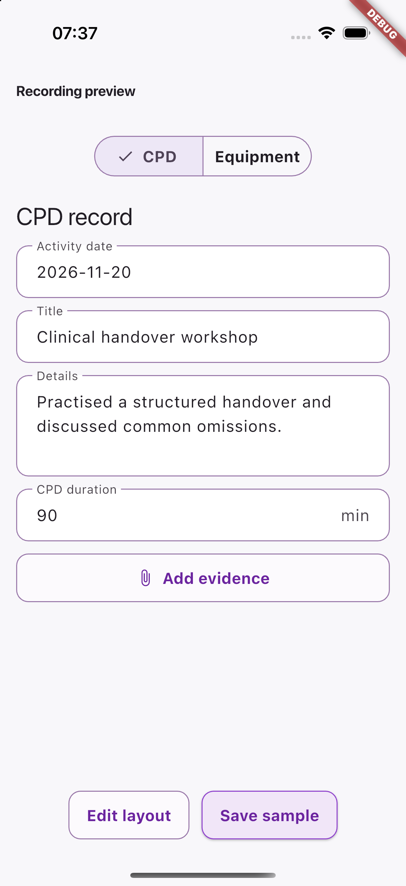
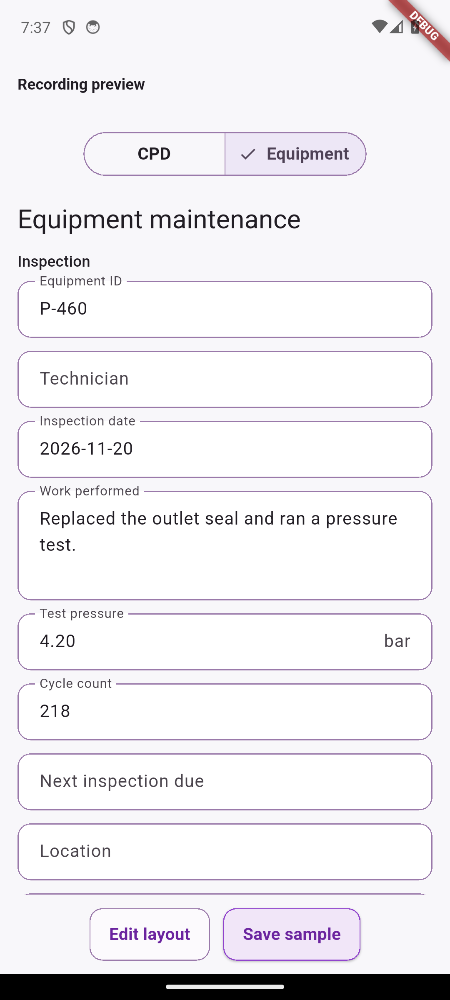

# Phase 4 recording configuration

**21 November 2026 · Internal milestone.** The generic field model, template metadata, layout drafts and versioned library work through the disposable SQLite repository. The free CPD form is represented with its five existing bindings. The same renderer opens an equipment-maintenance template. Normal CPD launches still use the existing UI and SharedPreferences.

## Architecture and data relationships

| Object | Stored identity and behaviour |
|---|---|
| Field definition | Stable definition ID and version. The immutable payload carries value type, validation, units, precision, ordered option IDs and labels, and default label translations. |
| Layout field instance | Stable ID within its collection, paired with an immutable definition in each applicable revision. The instance carries requiredness, label override, help, placeholder, a validated default, presentation format and optional catalogue origin. |
| Layout revision | Collection ID and incrementing revision. Stores ordered field instances, headings anchored to instances, optional template version and the explicit retrospective additions. A draft saves atomically against its base revision. |
| Template recipe | Independent ID and immutable version. Contains recipe-local field IDs, headings, origin and localised metadata. An adoption assigns fresh instance and heading IDs and retains recipe provenance. |
| Library definition | Stable catalogue ID and version distinct from both the field definition and installed field instance. Carries source reference, tags, categories, keywords, display translation, description and a field prototype. |
| Record and values | Stable record ID, collection, creation layout revision, edit version and deletion state. Sparse, typed JSON values keyed by instance ID and ordered attachment links. Defaults initialise new forms only when explicitly requested. |
| Evidence | Stable asset IDs reference managed originals, links or unresolved evidence. Records keep their original references when fields are retired. |

The engine uses plain Dart. The existing sqflite repository owns the schema and transactions. Layout and recipe snapshots carry their full effective fields once per revision. Records reference the revision and store sparse values. SQLite checks definition versions for payload conflicts at save time. This keeps historical rendering self-contained and avoids a schema migration for each field type.

The generic module imports no CPD models, Flutter widgets or entitlement services. CPD adapters own the activity date, credited duration, target calculations, legacy search and export rules. Scheme calculations and report rule versions remain in the CPD host design. General Record Keeping can use the same model, layout operations and repository with its own fixtures, application policies and renderers.

## Field types and validation

| Requirement | Phase 4 representation or decision |
|---|---|
| Single-line and multiline text | One string type with line presentation and optional maximum Unicode code-point count. Titles, names, objectives and reflections receive separate definitions when their semantics differ. |
| Integer | A Dart integer, optionally non-negative and labelled with a unit. Suitable for counts. |
| Decimal | A base-10 string with up to the definition's configured fractional digits. Trailing zeroes are retained. Input excludes scientific notation, thousands separators and rounding. Unit and precision are part of semantic compatibility. Locale-aware parsing belongs to the input presenter. |
| Date | A valid ISO calendar day with no time zone or time of day. CPD retains its own date rules. |
| Time, date and time | Deferred. Add after a demonstrated use case chooses time-of-day versus instant semantics and handling of time zones and daylight saving. |
| Duration | Integer minutes. Credited minutes, NMC participatory minutes and ethics minutes can use distinct definitions on the same primitive. Subset and eligibility rules are host validations. |
| Single and multiple selection | Stable IDs and ordered labels inside an immutable definition version. Multi-select requires distinct recognised IDs. Competency and standards fields can use these primitives. Linked taxonomy hierarchies and per-choice translations are deferred. |
| Yes/no and checkbox | One Boolean type. The widget format chooses yes/no or checkbox. An absent value and explicit false are distinct. |
| URL | An HTTP or HTTPS address. The engine stores and validates the value. Link handling belongs to the host. |
| File attachment and photograph | One ordered attachment type. A photograph is a presentation hint for the picker. MIME, camera and file validation remain host responsibilities. |
| Location | Text can record a place or site ID. Coordinates, map integration and location permissions are deferred. |
| Section heading | An optional presentation element with its own ID and an anchor before a field, or at the end. A heading holds no value and does not count towards the CPD cap. Complex sections, repeating groups and conditional layouts are deferred. |
| Structured credits and allocations | Separate exact inputs can carry a stable unit and definition. Multi-field allocation, conversion, eligibility and scheme-specific calculations require a researched report/rule version. A lookalike field label has no regulatory effect. |

The [field-type research](../field_type_recommendations.md) and [reporting requirements](../reporting_requirements.md) identify practical inputs including dates, evidence, free-text reflection, type-specific durations and scoped choices. Phase 4 support in the model does not select the initial user-facing type list. Formatting is deliberately limited. Accessibility labels, reorder alternatives, error focus and localised controls belong to the Phase 5 presenters.

## Versioning and historical resolution

| Change | New layout behaviour | Existing record behaviour |
|---|---|---|
| Local label, help, placeholder, required flag, formatting, order or default | Save a layout revision with the same instance ID. | The original render and validation remain in effect. A new requirement leaves an untouched old record valid for unrelated edits. |
| Definition label, validation or choice rename/reorder | Save a new definition version. Keep option IDs whose meaning is unchanged. | Existing values remain searchable, displayable and exportable with the old labels and validation. |
| Retire a choice or divide it into different meanings | Exclude the old ID from the next definition version. Allocate fresh IDs to new meanings. | The old choice remains resolvable and can still be edited under the historical definition. |
| Add an instance | Choose future-only or explicit retrospective applicability. | Historical records receive an available blank slot only on the retrospective path. A default never backfills it. |
| Retire an instance | Remove it from the draft and save a revision. A heading anchored to it leaves that draft unless re-anchored. | The old instance, values, attachment links and historical presentation remain. A retired ID cannot be resurrected in a later saved revision. |
| Change type, unit, precision or domain meaning | Use a new instance. The engine blocks in-place type, unit and precision changes. Authors assign new identities for domain changes the engine cannot infer. | Values and evidence continue to resolve against the original definitions. There is no automated conversion. |
| Adopt another template or a revised recipe | Apply the chosen immutable version explicitly for new records. Each adoption has its own instance IDs, order and anchors. | Existing records continue to resolve from their creation layout and its original recipe provenance. |
| Update bundled Field Library | New insertion can use the new catalogue version. | Existing instances retain their effective snapshot and insertion provenance, including after user renames or compatible revisions. |

The same resolver is used for historical value edits, generic record search and long-form export rows. A record takes the original field order, then adds explicitly retrospective fields using the first version that applied. Generic export rows include stable IDs, revision, type, unit, exact stored JSON and the historical display value. Human-facing CSV encoding and spreadsheet-safe policy belong to the exporting host. CPD's existing PDF and CSV paths retain their own view models.

## Layout operations and Field Library

A disposable working draft holds full tiles and independent headings. Reordering moves the field with its configuration, stable ID and evidence semantics. The draft supports add, reorder, configure and retire. The repository revalidates the resulting active count and expected layout version on Save. A stale draft fails without replacing the active layout. Cancel discards the draft. The CPD example supplies the same 20-field cap at template validation, adoption and draft save. The shared engine lets other hosts supply their own limits.

The internal catalogue contains eight representative definitions from the [international catalogue](field_library.md) and [source register](../source_register.md). The catalogue browses by category and filters by tags such as NMC. Search matches terms across labels, descriptions, aliases and category names, including the base and requested locale. French fixture labels exercise language fallback. Each result carries its type, source or scope where relevant, and enough metadata to preview it. The eight examples are learning provider, learning objective, practice impact, participatory time, California RN contact hours, NMC Code themes, supporting evidence and evidence photograph. Their inclusion is for testing. It does not imply regulator approval, scheme eligibility or official submission compatibility.

Search currently scans the small installed catalogue. Generic record search uses the values projected from historical revisions. Reuse resolved fields per revision in larger lists, and benchmark indexed collection, range and quick-search queries on actual low-end devices before adding projections or FTS. A simpler value table per type would add joins and migrations as types grow. One complete record JSON blob would make partial transactional edits and explicit evidence relations harder. Normalising all recipe snapshots to foreign-key references could reduce repeated definitions if revision counts become large. Current snapshots trade modest per-revision storage for straightforward restore and rendering. No Phase 4 performance benchmark is claimed. The [Phase 3A measurements](phase3a_migration_readiness.md#measurements-on-20-november-2026) concern legacy migration.

## Free CPD and equipment verification

The free fixture reuses the canonical activity date, title, details, exact credited minutes and evidence definitions used by migration and the CPD adapter. The standard collections, targets, historical ordering, search, deleted records and PDF, CSV and evidence export behaviour are still CPD host responsibilities. Optional paid templates can extend the same form using reviewed extra fields and host-side rules. The CPD template application path in Phase 5 must preserve the bound date and duration and retain the standard behaviour. The generic recipe operation itself creates independent instances. No premium rules or reports are implemented here.

The equipment fixture uses asset ID, maintenance dates, work performed, exact pressure, cycle count, status, notes, safety check, manual URL and evidence. The native test creates records, rejects a floating-point pressure, edits an old record, applies future-only and retrospective fields, retires a pressure and evidence field, and applies a second recipe. Reopening the database retains the old pressure in bar, the original file bytes, the old status text for search and exports, and the new layout for later records. The fixture uses no CPD definitions or calculations.

## Migration and recovery

SQLite schema 4 adds one settings column to each of the layout and template tables. Existing rows have empty optional metadata and keep their old field definitions and values. Previously persisted JSON without the new optional keys continues to round-trip. Import verification includes layout settings. The normal SharedPreferences writer, startup authority guard, synthetic recovery flow and 30-day retention safeguards remain in place.

A portable backup with custom layouts will need the complete layout and template revision chain, embedded field/choice definitions, exact JSON values and referenced originals. A future reader should check its ability to decode the store and verify references and file digests before admitting data. Unsupported future types should be held for recovery until a compatible reader is available. Review interchange format and downgrade policy separately. The schema/version change here applies to explicitly opened recording-engine rehearsal databases.

Missing historical evidence may be marked with a warning while otherwise valid migration proceeds. Ambiguous values stay in the recovery path with their original payload and no inferred correction. A signed upgrade on iOS 15.6 and Android API 24, physical-device rehearsal, and proof that a recovered replacement database retains all acknowledged post-activation writes remain mandatory release gates. Production migration and SQLite activation stay disabled. [Phase 3A safeguards](phase3a_migration_readiness.md) · [Phase 3B authority and recovery](phase3b_migration_readiness.md)

## Internal demonstration

Use a distinct disposable debug app and follow the [Phase 3B scratch setup](phase3b_migration_readiness.md#running-the-disposable-app). Copy the current library and tests, then launch either of these targets.

```sh
flutter run -d DEVICE_ID -t test/recording_engine/phase4_demo_app.dart
flutter run -d DEVICE_ID -t test/recording_engine/phase4_demo_app.dart --dart-define=RECORDING_PREVIEW=equipment
flutter run -d DEVICE_ID -t test/recording_engine/native_phase4_fields.dart
```

The preview switches between two sample forms driven by the same renderer. It saves synthetic records to its temporary SQLite database. Edit layout exercises handle-only drag, rename, retirement and the two add paths using sample fields. It is a disposable harness. It uses a synthetic evidence link and has no production navigation, purchase state or legacy storage access.

| Free CPD on iOS 18.5 simulator | Maintenance on Android API 34 emulator |
|---|---|
|  |  |

[Android layout draft after inserting and reordering the Learning objective field](phase4_screenshots/layout_draft.png).

## Verification results

| Check | Result |
|---|---|
| Full Flutter regression suite | 136 tests passed, including seven new field, catalogue and layout tests. |
| Static analysis | 16 pre-existing findings in the app, research probes and local marketing output. Zero findings in Phase 4 files. |
| Native Phase 4 SQLite | Passed on iPhone 16 Pro (iOS 18.5 simulator) and Pixel 6 (Android 14, API 34 emulator). Verified creating, editing, historical projection, original evidence bytes, schema 3 upgrade and schema 4 reopen. |
| Native CPD legacy parity | Five scenarios passed on each runtime. The suite checks CPD records, targets, evidence, PDF/CSV and conditional ZIP, and compatibility and recovery paths. [Phase 2 suite details](phase2_compatibility_validation.md) |
| Native migration authority | The Phase 3B authority and recovery suite passed on both runtimes. |
| Interactive preview | Saved a CPD sample on Android, inserted the Learning objective field, moved it by its drag handle and saved the layout. Captured both record forms and the Android draft using synthetic data. |
| Minimum platforms | iOS 15.6 and Android API 24 were unavailable. No signed upgrade or dedicated physical-device test was run. |

## Phase 5 decisions

1. Approve the initial user-facing field types, locale-aware decimal input, supported formats and accessibility behaviours. Test drag handles, keyboard Move actions, screen-reader ordering and small-screen modal flows before finalising them.
2. Agree the CPD canonical-field edit and template-application policy. Preserve bound date, credited duration, target rules and free exports. Define how fixed templates, customised copies and explicit upgrades appear in the editor across tiles.
3. Approve reviewed catalogue entries, source wording and whether users can restore retired options in new layouts. Define confirmation copy for replacement, historical applicability and reserved scheme terms. Keep destructive historical deletion on a separate authorised workflow.
4. Decide how to version and verify future portable backups, including restore from older app versions and complete acknowledged-write coverage after activation. Treat signed minimum-OS and physical-device checks as a separate gate.
5. Authorise Phase 5 separately. Use the existing free form controls where practical, connect the visual editor and searchable picker to the draft API in the rehearsal app, and compare entry and export before any production integration. [Custom Fields UI specification](../../../docs/custom_fields_ui.md)
