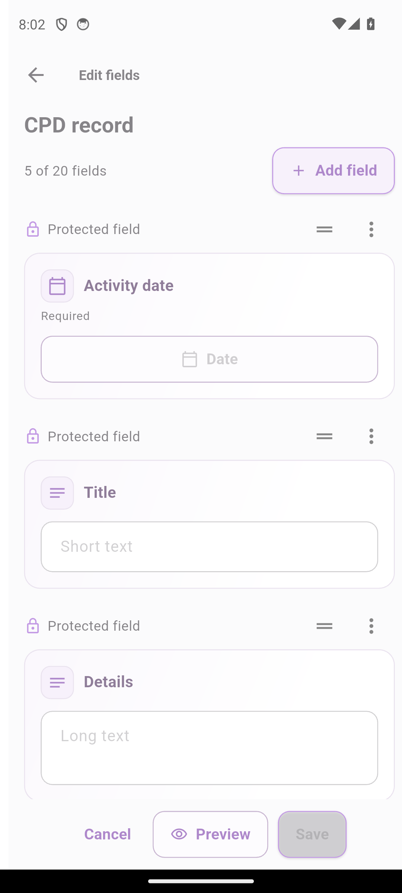
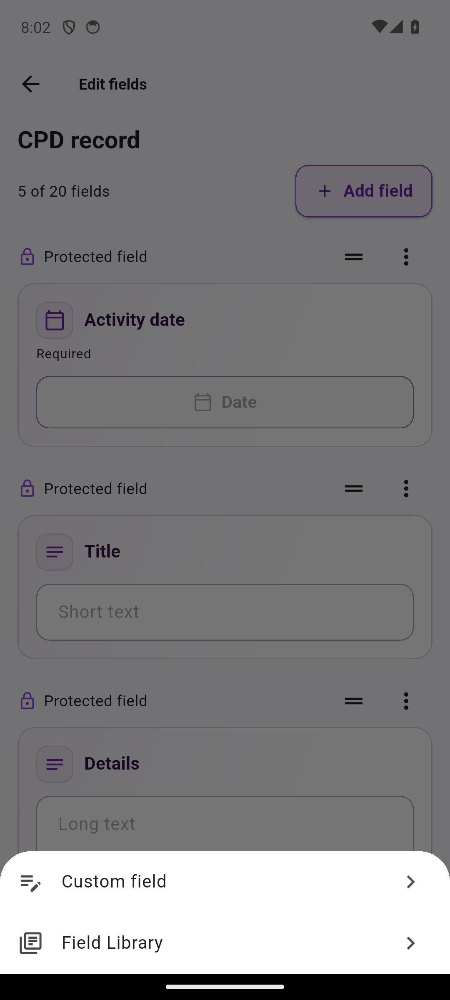
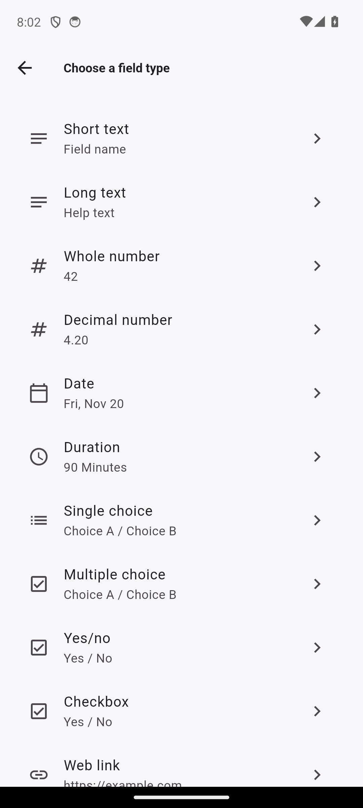
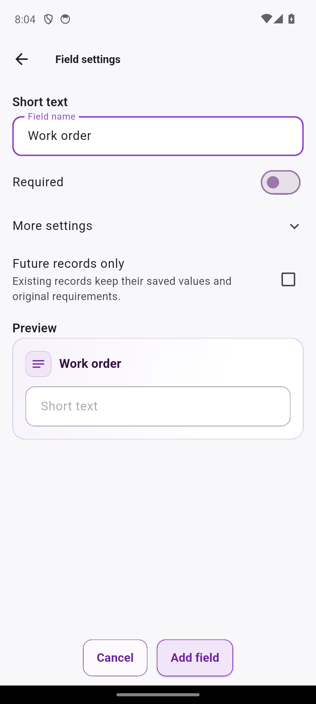
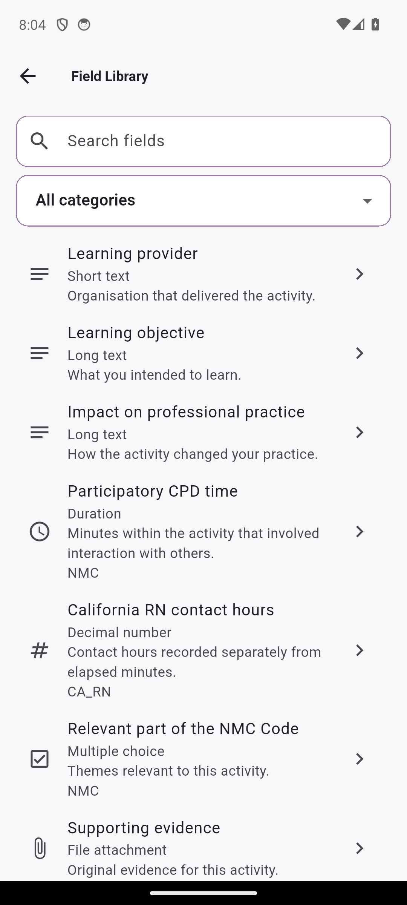
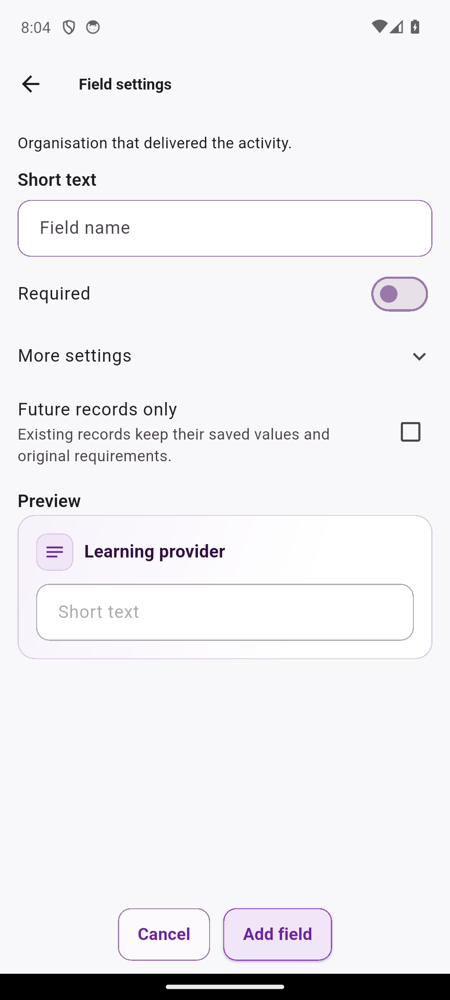
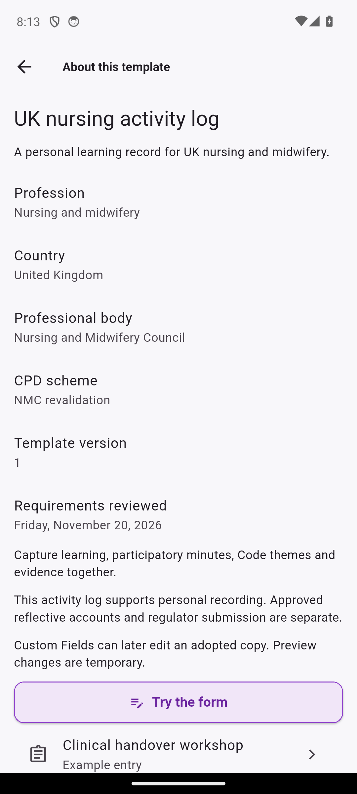
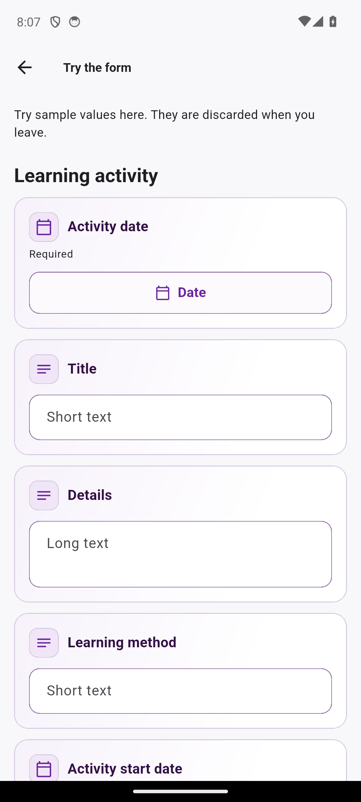
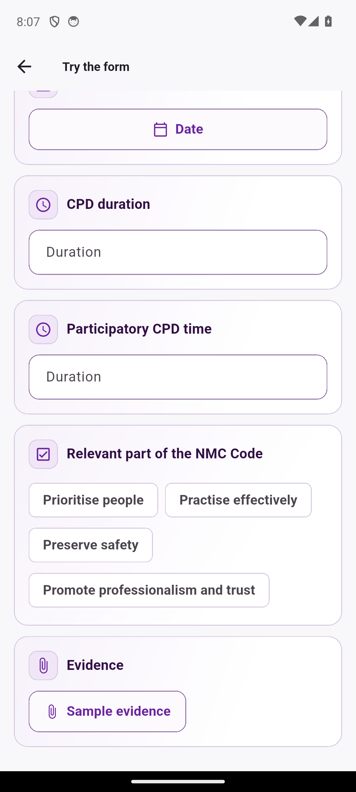

# Phase 5 visual editor and template previews

**21 November 2026 · Internal rehearsal.** Phase 5 adds a form-style layout editor, guided custom-field settings, a searchable Field Library and the preview contract for future profession-template purchases. The free CPD form, a UK nursing activity log based on the NMC research and the generic equipment-maintenance form all use the same recording renderer. Only the disposable Flutter target links the editor into a running app. The published app continues to use its existing screens and SharedPreferences.

## Editing a layout

Open **Edit fields** in the rehearsal. The layout shows a field count, representative form controls, a dedicated drag handle and a menu for each tile. The menu offers settings and, where applicable, Move up, Move down, Duplicate and Remove. Reorder moves the whole tile. Menu actions and drag both use the same ordering logic for fields and section headings. A live region carries the new position for assistive technology.

**Add field** opens the Custom field or Field Library sheet. A custom field starts with a type and example, then presents a focused settings page. Providing a name is enough to add a simple text field. Library selection opens the same settings page with a preview, researched description and source provenance in the installed field. The list supports search and category browsing and keeps its context when returning from settings. An already used library item is marked and adding another copy requires confirmation. There are ten CPD fixtures across activity details, learning and reflection, time and credits, standards and competencies, and evidence. The equipment demo supplies a separate service catalogue. [Research Field Library](field_library.md)

The default scope is future records. The editor can explicitly expose an added field to older records as well. This leaves it optional on those records, with no default value written back. New records enforce active required fields. Settings, drag and add/remove actions affect only the draft until Save. The draft uses the base revision for optimistic checks. Save failures leave the draft open. Cancel or back asks before discarding changes. A 20-data-field limit applies to CPD, including the five standard fields. Section headings stay outside the count and can still be added when the layout is full. Separate undo and draft recovery across relaunch were deferred. Confirmation and the unsaved draft provide recovery before saving.

## Field types and settings

| Types | Settings in this rehearsal |
|---|---|
| Short and long text | Label, required, help, placeholder and text default. Type controls the line presentation. |
| Whole numbers and exact decimals | Label, required, help, placeholder, optional unit and non-negative constraint. Decimal precision and defaults use exact stored values, with locale-aware decimal display and input. |
| Calendar date and duration | Date picker with calendar-day storage. Duration uses integer minutes. Both offer appropriate defaults. CPD credited duration remains bound to standard calculations. |
| Single and multiple choice | Stable option keys, user-edited options, required status and optional default. Historical options remain attached to the original field snapshot. |
| Yes/no and checkbox | Boolean data. Display format can switch between these controls without changing value meaning. |
| Web link | HTTP or HTTPS validation, hint and optional default. The rehearsal presents a field and does not open arbitrary links. |
| File attachment and photograph | Managed evidence identity and optional photo affordance. No pre-filled user attachment; sample forms offer synthetic evidence only. |
| Section heading | User-authored text and reorderable position. No stored record value. |

Unit, precision and local choice changes explicitly replace the active field for future records. This keeps existing records on the older snapshot and gives each customised copy its own definition identity. A compatible publisher-controlled choice set can still be versioned on a stable field by the engine. Changing the underlying type can be expressed by retiring a field and adding another; there is no record conversion workflow. Arbitrary min/max, rich text, time-of-day, timestamp time-zone policy, informational blocks and structured location need additional validation, persistence or accessibility design. Place names can use a text field. [Phase 4 field catalogue](phase4_recording_configuration.md#field-types-and-validation)

## CPD field protection and history

| Binding | Reason it is protected |
|---|---|
| Activity date | Existing entry, reporting periods, ordering and filters use the same calendar day. |
| Credited duration | Totals and targets depend on exact credited minutes. Additional durations or awarded credits cannot replace it. |
| Title and details | The free app uses these as alternative sources of activity text and in summaries, search and exports. Neither is independently mandatory. |
| Evidence | Existing add/edit, historical evidence and export paths use the canonical evidence binding. Individual records can have no evidence. |

The editor allows changes to display names, placement and appropriate help and placeholder text on these fields. The CPD host validates stable bindings and existing requiredness, defaults and presentation constraints before saving. It rejects deletion, type changes or replacement with a lookalike. Extra fields have no canonical protection. The generic editor receives the protected IDs and has no CPD calculation, commercial or entitlement dependency.

Existing records open with their creation-time definitions plus explicitly retrospective additions. The rehearsal groups retired fields separately. Renames do not alter historical labels. Removed fields, source evidence and retired options remain available. A changed unit uses a replacement instance while the old record still projects its original unit and exact value. A duplicate receives independent identity and has no copied record values. Historical export uses the resolved version and preserves raw values. The rehearsal can create and edit synthetic records, show historical exports, and reopen the same SQLite sample database.

## Pre-purchase template preview

The generic renderer is shared by the editor, record page and template preview. The template detail page receives the complete immutable recipe plus profession, country, professional body, scheme, reviewed date, features, limitations and customisation notes. The UI derives layout, labels and controls from that recipe. It can open an interactive form, read-only completed examples and a generated example PDF. The UK nursing fixture demonstrates the contract and exposes no claim of regulator approval or completeness. [NMC research specification](../uk/nmc.md)

The interactive preview holds temporary values in widget state. It can show designated sample attachments but has no file picker, camera, upload or evidence store. The report receives synthetic example input. The PDF viewer disables print and share. Neither mode receives a writer, installer, collection ID, statistics service or purchase mutation callback. Leaving the form discards edits. The internal template page is available without purchase. The future catalogue will use the same preview contract for any user; only the CPD host can authorise purchase, restore and applying a version to a tile. The example PDF is illustrative and currently built from the fixture. Phase 6 should bind an approved report provider to the same recipe and rules version that an owner will use.

## Template updates and authoring

The comparison takes the published original, the exact immutable adoption revision, the current installed layout and the proposed update. The adoption snapshot lets it map stable recipe keys to independently allocated local instances. It reports publisher additions, retired/changed fields and ordering, alongside local additions, removals, edits and reordering. The comparison performs no write and keeps original template provenance. A future approval screen should show existing custom fields and user changes, assign selectors per compatible update, explain conflicts or unavailable mappings and preview the resulting form. A replacement must use a fresh field instance where meaning changes. Commit only on a confirmed transaction; earlier records keep their snapshots.

The same editor can author reviewed templates. The development-only JSON codec validates the recipe and field-version identities and emits deterministic versioned content, preserving field order, choice order, IDs, presentation anchors and translated metadata. Recommended Phase 6 export flow: project an explicitly selected draft into a recipe with durable author-assigned keys, record locale, sources and review date, run round-trip and snapshot comparison in CI, and include only the approved recipe and synthetic preview inputs in the bundle. Keep sample assets, rule version and report digest in the CPD host manifest. Existing records, attachment paths, collections, purchases and entitlement state are outside recipe authoring. Distribution remains the app bundle and reviewed updates.

## Screenshots

| Edit fields | Add field | Choose type |
|---|---|---|
|  |  |  |

| Custom field | Field Library | Library field |
|---|---|---|
|  |  |  |

[Draft preview](phase5_screenshots/layout_preview.png) · [Retired field in an older record](phase5_screenshots/historical_fields.png).

| Template details | Interactive form | Controlled choices |
|---|---|---|
|  |  |  |

[Completed example record](phase5_screenshots/template_example.png) · [Generated example PDF](phase5_screenshots/template_report.png). All screenshots use synthetic data from the Android rehearsal.

## Localisation and accessibility

Editor controls and feedback use the existing ARB workflow in English, German, Spanish, French, Hindi and Portuguese. Widget tests cover the small-screen editor and searchable library at 360 × 700 logical pixels with 170% text and all eight app accent choices. They also cover semantics labels, the menu reorder path, keyboard input and discarding a preview. The renderer uses the locale for date and decimal presentation. User-authored labels are retained as entered. The research definitions, sample records, evidence labels and sample PDF still have English fallback where fixture translations are absent. Phase 6 needs a translated and reviewed content bundle. Physical VoiceOver, TalkBack and hardware keyboard testing are release checks.

## Running the rehearsal

Use a disposable application ID and copy the current sources and test targets using the [Phase 3B scratch setup](phase3b_migration_readiness.md#running-the-disposable-app). The interactive target has its own sample database under its scratch app support directory. The native verification target uses a fresh temporary database.

```sh
flutter run -d DEVICE_ID -t test/recording_engine/phase5_rehearsal_app.dart
flutter run -d DEVICE_ID -t test/recording_engine/phase5_rehearsal_app.dart --dart-define=EDITOR_LOCALE=fr
flutter run -d DEVICE_ID -t test/recording_engine/native_phase5_editor.dart
```

## Verification

| Check | Result |
|---|---|
| Flutter regression suite | 151 passed, including 15 new editor and engine tests. |
| Static analysis | No findings in the editor, engine, CPD adapter or recording tests. Full-project analysis reports the 16 existing findings in other app files, local marketing output and research probes. |
| Phase 5 native SQLite | Passed on both runtimes. Verified field retirement, original values and units, a new required field in an old record, renamed labels, retired choice IDs, duplicated fields, independent template updates, CPD protections, exports and database reopen. |
| Native regression | Phase 2 legacy parity passed five scenarios on each runtime, including CPD date/duration/target behaviour, actual PDF, CSV and evidence ZIP, raw snapshot recovery, SQLite full and additive upgrade. Phase 3B migration authority and recovery also passed on both. |
| Android interaction | Added a custom text field and a library field, previewed and saved the layout, and confirmed it after relaunch. Created a record with the custom field, relaunched, retired the field, opened its historical group and checked the original in the export. Edited the retired value and confirmed the updated export after reopening the record. Also viewed the nursing template, controlled choices, completed example and generated PDF. |
| Runtime coverage | iPhone 16 Pro simulator on iOS 18.5 and Pixel 6 emulator on Android 14 (API 34). Minimum-version runtimes and physical signed upgrades were unavailable. |

## Known limits

The editor remains an internal page. Current attachment controls use synthetic evidence, the PDF is a generated rehearsal artifact, and installed template comparison is a read-only model. Phase 6 needs the reviewed catalogue, real scheme reports, a selectable update flow and audited production-quality localisation. A stale layout save keeps the draft available, with reload and conflict resolution deferred to the public integration design.

## Release gates and Phase 6

1. Authorise the initial profession-template field specifications and each sample dataset. Have practitioners compare the free app, editable copy and complete pre-purchase experience, including representative exports.
2. Agree the presentation and rollout of numeric, choice and evidence options. Resolve rule versioning, official versus supporting report outputs, review cadence and localised product content before bundling any commercial template.
3. Verify real devices with VoiceOver, TalkBack, larger accessibility font settings and hardware keyboards. Confirm export readability, field insertion focus, colour/contrast and drag on older supported devices.
4. Keep purchasing, activation and entitlement checks out of the reusable renderer. Connect them only through separately approved CPD host and store work. Build previews from the same approved sources used for the owned form and example report.
5. Retain the existing release gates. Signed upgrades on iOS 15.6 and Android API 24, dedicated physical-device tests and proof that recovery retains every acknowledged post-activation write remain mandatory. Production storage activation stays disabled.
